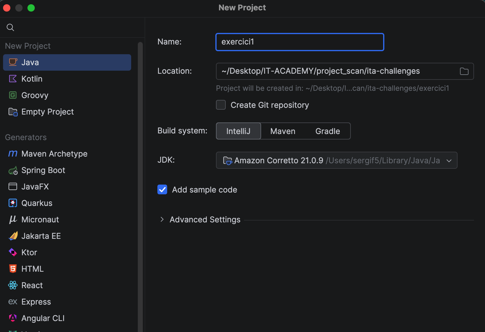
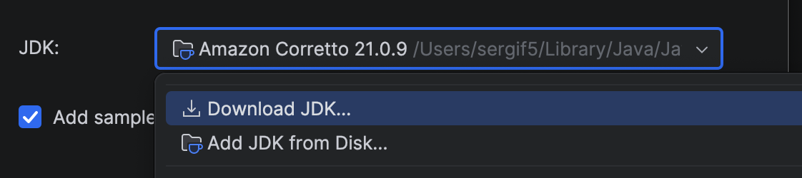
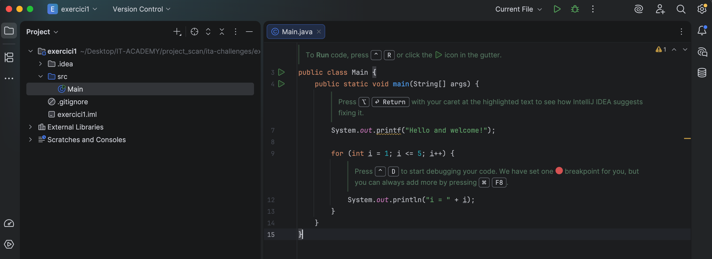
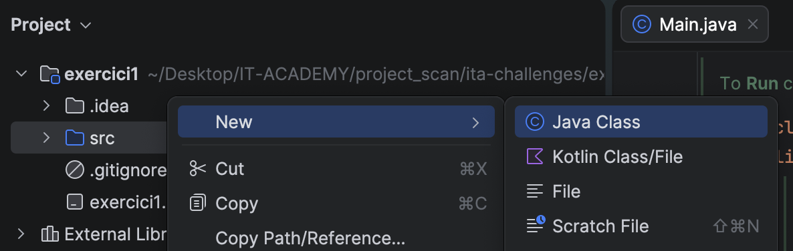

# Entorn de desenvolupament en Java

## Objectiu

Preparar l'entorn per poder crear i executar un primer programa Java amb IntelliJ IDEA.

En aquesta activitat no treballarem encara la sintaxi de Java en profunditat. L'objectiu és tenir l'entorn preparat i veure un primer missatge a la consola.

---

## 1. Descarregar IntelliJ IDEA

Per treballar amb Java farem servir **IntelliJ IDEA**, un IDE de JetBrains molt utilitzat en projectes Java.

Descarrega la versió **Community Edition** des de la web oficial:

[https://www.jetbrains.com/idea/download](https://www.jetbrains.com/idea/download)

Un cop descarregat, instal·la'l i obre'l.

---

## 2. Crear un projecte Java

Quan obris IntelliJ IDEA, crea un projecte nou.

Passos:

1. Clica **New Project**.
2. Selecciona **Java**.
3. Escriu el nom del projecte.
4. Revisa la carpeta on es guardarà.
5. Comprova que el **JDK 21** està seleccionat.
6. Deixa seleccionada l'opció d'IntelliJ IDEA com a sistema de build.
7. Marca l'opció **Add sample code**.
8. Crea el projecte.



En aquest primer bloc ens interessa que IntelliJ s'encarregui de compilar i executar el programa. Per això deixarem la configuració simple que apareix al quadre de diàleg.

---

## 3. Configurar o descarregar Java 21

Per programar amb Java necessitem un **JDK** (*Java Development Kit*).

El JDK permet:

- compilar codi Java,
- executar programes Java,
- treballar amb projectes Java des d'IntelliJ.

En aquest curs instal·larem i farem servir **Java 21**.

Si no tens cap JDK instal·lat, IntelliJ et pot oferir descarregar-ne un directament des del quadre de creació del projecte. En aquest cas, selecciona **Java 21**.



No cal memoritzar ara totes les opcions. L'important és que el projecte tingui **Java 21** seleccionat abans de crear-lo.

---

## 4. Buscar el fitxer Java inicial

Com que hem marcat **Add sample code**, IntelliJ crearà automàticament un primer fitxer Java dins del projecte.

Busca el fitxer generat. Normalment trobaràs una classe amb un mètode `main` i algun `System.out.println()` de prova.

No cal modificar aquest codi ara. Primer comprovarem que el projecte s'executa correctament.

Idees importants:

- El fitxer Java estarà dins de la carpeta del projecte.
- La classe principal acostuma a contenir el mètode `main`.
- El programa comença a executar-se dins del mètode `main`.
- El codi generat per IntelliJ ja serveix per fer la primera prova.

---

## 5. Executar el programa

Per executar el programa, fes servir el botó de **Run** d'IntelliJ.

Quan el programa s'executi correctament, hauràs de veure un missatge a la consola.



En Java, abans d'executar el programa, el codi es compila. IntelliJ fa aquest procés automàticament quan prems **Run**.

---

## 6. Crear noves classes Java

Quan ja tens el projecte creat, pots crear noves classes Java des d'IntelliJ IDEA.

Això et servirà per fer els exercicis en fitxers separats.

Passos:

1. Ves a la carpeta `src`.
2. Clica amb el botó dret.
3. Selecciona **New**.
4. Selecciona **Java Class**.
5. Escriu el nom de la classe.
6. Prem **Enter**.



Algunes recomanacions:

- Escriu noms de classe amb majúscula inicial, per exemple `Exercici1`.
- Evita espais i accents en el nom de la classe.
- Si la classe es diu `Exercici1`, el fitxer serà `Exercici1.java`.
- Una classe només es podrà executar directament si té un mètode `main`.

Exemple:

```java
public class Exercici1 {
    public static void main(String[] args) {
        System.out.println("Primer exercici");
    }
}
```

A partir d'aquí, pots executar aquesta classe amb el botó **Run** si IntelliJ detecta el mètode `main`.

---

## Errors habituals

Si alguna cosa no funciona, revisa aquests punts:

- IntelliJ no troba cap JDK instal·lat.
- No hi ha cap JDK seleccionat al projecte.
- El projecte s'ha creat en una carpeta incorrecta.
- No has localitzat el fitxer Java generat per IntelliJ.
- Falta el mètode `main`.
- Falta algun `;`.
- Falta alguna clau `{}`.
- Has escrit `print()` en lloc de `System.out.println()`.
- Has escrit text fora de la classe o fora del mètode `main`.
- Has creat la classe fora de la carpeta `src`.
- La classe no té mètode `main` i per això no apareix l'opció d'executar.

Llegir els errors és part del procés. No cal entendre tot el missatge al principi, però sí intentar identificar la línia on IntelliJ marca el problema.

---

## Checklist final

Abans de passar als exercicis, comprova que pots fer això:

- Tinc IntelliJ IDEA instal·lat.
- Puc crear un projecte Java.
- He triat el nom i la carpeta del projecte.
- Tinc Java 21 configurat com a JDK.
- He marcat **Add sample code** en crear el projecte.
- Puc trobar el fitxer Java generat per IntelliJ.
- Puc executar el programa.
- Veig el resultat a la consola.
- Puc crear una nova classe Java.
- Sé que una classe necessita un `main` per executar-se directament.

Quan tinguis això funcionant, ja pots començar amb els primers exercicis de Java.
