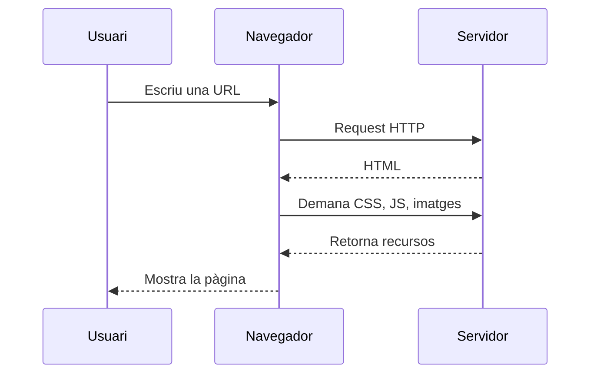
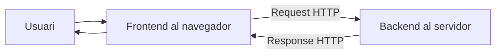
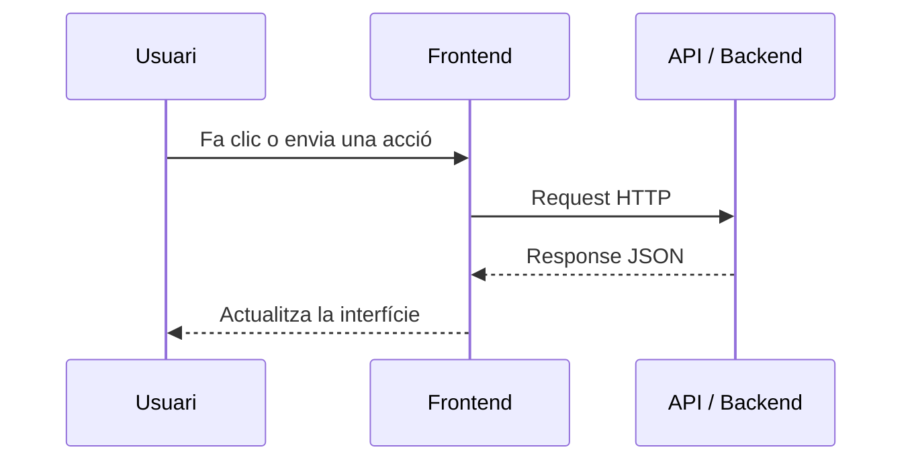
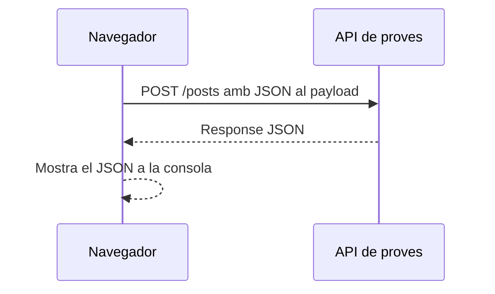

# DevTools: Fonaments pràctics de la Web

Abans de decidir si vols orientar-te cap a frontend o backend, necessites entendre com funciona la web a nivell general. Primer mirarem què passa en qualsevol pàgina web quan l'obres al navegador.

En aquesta activitat no hauràs d'implementar codi. L'objectiu és observar, relacionar conceptes i començar a entendre el recorregut complet d'una acció: des que escrius una URL o fas clic en una pàgina fins que el navegador mostra una resposta.

> **Nota:** En aquest bloc només busquem una idea general i d'alt nivell. Durant el curs veuràs aquestes tecnologies amb molta més profunditat.

---

## Objectius

En acabar aquesta activitat hauràs entès:

- Què és una aplicació web.
- Què vol dir client-server.
- Què fa el navegador quan obres una pàgina.
- Quina diferència hi ha entre HTML, CSS i JavaScript.
- Què són una request i una response HTTP.
- Què és una API, que és i per què a que s'utilitza JSON.
- Com observar una web amb DevTools (eines de desenvolupament del navegador).
- Com veure el JSON que envia i rep el navegador.

---

## Què és una aplicació web

Una aplicació web és un sistema que utilitzes des del navegador. Pot ser una pàgina molt simple, com una documentació, o una aplicació complexa, com GitHub, Gmail, Spotify Web o una botiga online.

Quan obres una web el navegador demana recursos, per exemple tots els llibres d'una biblioteca, a un o més servidors i després els interpreta per mostrar una interfície.

Una web acostuma a combinar diverses peces:

- **HTML**, que defineix l'estructura o la semàntica del contingut en la vista de l'usuari.
- **CSS**, que defineix l'estil visual dels elements que mostra el dfrontend.
- **JavaScript**, que afegeix interacció en el navegador, executante en el frontend.
- **Imatges, fonts i altres recursos**. que han de ser carregats per els clients navegadors en el moment de lexecució
- **Dades**, sovint rebudes des d'una API. en formats com JSON desde el servidor

```text
HTML + CSS + JavaScript + recursos + dades = experiència al navegador
```

No totes les webs utilitzen totes aquestes peces de la mateixa manera. Una pàgina de documentació pot ser més estàtica. Una aplicació com GitHub és molt més dinàmica i fa moltes peticions a servidors mentre navegues.

---

## Model client-servidor

La web funciona principalment amb un model **client-server** (client-servidor).

El **client** és qui demana alguna cosa. fent una petició o request a un backent que té un servidor web. Normalment és el navegador pero també pot ser un altre backend o una app movil per exemple.

El **servidor** és qui rep la petició, la processa segons certes normes del negoci, treballa amb les dades internes de la aplicació i retorna una resposta o request que el client interpretarà.

```text
Usuari -> Navegador -> Internet -> Servidor -> Resposta -> Navegador
```

En una web, el navegador gairebé sempre inicia la comunicació. El servidor no envia una pàgina perquè sí: respon a una petició.

Exemple simple:

1. Escrius [https://developer.mozilla.org](https://developer.mozilla.org/) al navegador.
2. El navegador demana la pàgina al servidor.
3. El servidor retorna HTML.
4. El navegador llegeix l'HTML i demana més recursos: CSS, JavaScript, imatges, fonts.
5. El navegador construeix la pàgina visual que veus.



---

## Què fa el navegador

El navegador, com a client HTTP, no només “mostra pàgines”. Fa molta feina:

- interpreta HTML,
- aplica CSS,
- executa JavaScript,
- descarrega recursos,
- gestiona cookies i emmagatzematge local,
- fa peticions HTTP,
- mostra errors a la consola,
- actualitza la pantalla quan canvien les dades.

Per això el navegador és una eina clau tant per frontend com per backend. Encara que vulguis fer backend, has d'entendre què envia i què rep el client.

---

## Frontend i backend

El **frontend** és la part visible d'una aplicació web: el que veus i amb què interactues al navegador.

Per exemple:

- un botó,
- un formulari,
- una card,
- un menú,
- un tauler de joc,
- un missatge d'error.

El frontend s'encarrega de mostrar informació i capturar les accions de l'usuari. I principalment treballarem amb les tecnologies web standard i sobre frameworks com React o Angular.

El **backend** és la part que s'executa al servidor. No la veus directament, però decideix què passa amb les dades i modela la lògica de l'aplicació.

Per exemple:

- valida una jugada,
- decideix si pots accedir a una funcionalitat,
- guarda informació,
- calcula un resultat,
- consulta una base de dades,
- retorna una resposta al frontend.



En aquest curs, el backend el treballarem principalment amb Java i Spring Boot o PHP i Laravel. Ara només necessites entendre quin paper juga dins d'un sistema Web.

---

## Request, response i HTTP

[HTTP](https://developer.mozilla.org/en-US/docs/Web/HTTP/Guides/Overview) (Hyper Text Transfer Protocol): és el protocol principal que utilitzen navegador i servidor per comunicar-se a través d'internet.

Una **request** (petició) és el missatge que envia el client al servidor.

Una **response** (resposta) és el missatge que torna el servidor al client.

Exemple d'una request conceptual:

```http
GET /docs HTTP/1.1
Host: developer.mozilla.org
```

Exemple d'una response conceptual:

```http
HTTP/1.1 200 OK
Content-Type: text/html
```

Quan una web és més dinàmica, el navegador pot fer peticions mentre ja estàs dins de la pàgina. Per exemple, quan cliques un botó, filtres una llista, envies un formulari o carregues més resultats.

---

## Què és una API

Una **API** (Application Programming Interface) és una manera perquè dues parts d'un sistema es comuniquin amb unes regles concretes.

En una aplicació web, sovint el frontend parla amb el backend a través d'una API HTTP. El frontend no necessita saber com està organitzat el codi intern del backend. Només necessita saber quins endpoints pot cridar i quin format de dades rebrà.

Exemple:

```http
GET /api/products
```

Podria retornar una llista de productes.

```http
POST /api/orders
```

Podria crear una comanda.

Una API fa de contracte: indica què pots demanar, quines dades has d'enviar i quin tipus de resposta pots esperar.

---

## Què és JSON

Moltes APIs retornen dades en format [**JSON**](https://developer.mozilla.org/en-US/docs/Glossary/JSON) (JavaScript Object Notation). JSON és un format de text fàcil de llegir per persones i fàcil de processar amb codi.

Exemple:

```json
{
  "id": 1,
  "name": "Nala",
  "type": "Gos"
}
```

El navegador pot rebre aquest JSON, convertir-lo en dades de JavaScript i pintar-lo a la pantalla.



---

## DevTools: mirar la web per dins

Les [**DevTools**](https://developer.chrome.com/docs/devtools) (eines de desenvolupament del navegador) et permeten veure coses que normalment estan amagades.

En aquesta activitat mirarem sobretot dues pestanyes:

- **Elements**, per veure l'HTML i els estils que formen la pàgina.
- **Network**, per veure les peticions que fa el navegador.

També pot ser útil mirar:

- **Console**, per veure errors o missatges de JavaScript.
- **Sources**, per veure fitxers JavaScript carregats per la pàgina.

No cal entendre-ho tot. L'objectiu és començar a mirar una web amb mirada tècnica, no només com a usuari.

Quan entris a **Network**, veuràs moltes files. Cada fila és una petició que el navegador ha fet. Les més importants per començar són:

| Pestanya | Què hi pots veure? | Per què importa? |
|----------|--------------------|------------------|
| **Headers** | URL, mètode HTTP, status code i capçaleres | Et diu què s'ha demanat i com ha respost el servidor |
| **Payload** | Cos de dades enviat al servidor, si n'hi ha | Et mostra què envia el frontend en una request |
| **Preview** | Resposta interpretada pel navegador | És útil per llegir JSON de forma còmoda |
| **Response** | Resposta exacta del servidor | Et mostra el text real que ha tornat el backend o servidor |

Si una petició no té **Payload**, no passa res. Moltes peticions `GET` només demanen dades i no envien cos. En canvi, peticions com `POST`, `PUT` o `PATCH` acostumen a enviar dades ja que se solen usar per a crear o modificar recursos.

---

## Activitat 1: observa una web real

Primer observa una web real amb mirada tècnica.

Tria webs relativament simples. Per exemple:

- [MDN Web Docs](https://developer.mozilla.org/)
- [Spring](https://spring.io/)
- [GitHub Docs](https://docs.github.com/)

Evita webs molt carregades de publicitat, banners o popups. Poden generar moltes peticions i confondre't al principi.

### Passos

1. Obre una de les webs al navegador.
2. Obre DevTools.
3. Ves a **Elements**.
4. Selecciona algun títol, botó o enllaç de la pàgina.
5. Observa quin HTML representa aquell element.
6. Ves a **Network**.
7. Recarrega la pàgina.
8. Observa quantes peticions apareixen.
9. Filtra o busca recursos de tipus `document`, `css`, `js` o `img`.
10. Clica algun enllaç o element de la pàgina i mira si apareixen noves peticions.

### Què has d'intentar entendre

No cal que entenguis cada fitxer. Intenta respondre:

- Quina petició sembla carregar la pàgina principal?
- Veus fitxers CSS?
- Veus fitxers JavaScript?
- Veus imatges o fonts tipogràfiques?
- Quan cliques alguna cosa, apareixen peticions noves?
- La pàgina sembla més estàtica o més dinàmica?

---

## Activitat 2: observa una resposta JSON

Ara mirarem una API molt simple. No és una web visual com GitHub o MDN; és un endpoint que retorna dades en JSON.

Obre aquest enllaç al navegador:

[https://jsonplaceholder.typicode.com/users/1](https://jsonplaceholder.typicode.com/users/1)

Hauries de veure una resposta semblant a aquesta:

```json
{
  "id": 1,
  "name": "Leanne Graham",
  "username": "Bret",
  "email": "Sincere@april.biz"
}
```

### Passos

1. Obre DevTools.
2. Ves a **Network**.
3. Recarrega la pàgina.
4. Clica la petició que apareix a la llista.
5. Mira **Headers** i localitza el mètode `GET` i el `status code`.
6. Mira **Response** i comprova que el servidor ha retornat JSON.
7. Mira **Preview** i observa com el navegador presenta el JSON de forma més llegible.

### Què has d'intentar entendre

- El navegador ha fet una request a un endpoint.
- El servidor ha retornat una response.
- La response no és una pàgina HTML, sinó dades JSON.
- Aquest JSON podria ser utilitzat per un frontend per pintar una card, una taula o un perfil d'usuari.

---

## Activitat 3: observa una request amb dades  
  
Ara faràs una petició que envia dades amb `POST`.  
  
Obre aquesta pàgina:  
  
https://jsonplaceholder.typicode.com/  
  
Després obre DevTools i ves a la pestanya **Network**. Filtra per **Fetch/XHR**.  
  
Ara ves a **Console** i enganxa aquest codi:

```js
fetch('https://jsonplaceholder.typicode.com/posts', {
  method: 'POST',
  headers: {
    'Content-Type': 'application/json'
  },
  body: JSON.stringify({
    title: 'Primer post',
    body: 'Això és una prova des del navegador',
    userId: 1
  })
})
  .then((response) => response.json())
  .then((json) => console.log(json))
```

> **Nota:** Aquesta API és de proves. No estàs creant cap publicació real. Només serveix per veure com viatgen les dades.

### Passos

1. Executa el codi a **Console**.
2. Ves a **Network**.
3. Busca la petició a `/posts`.
4. Obre **Headers** i comprova que el mètode és `POST`.
5. Obre **Payload** i mira el JSON que has enviat.
6. Obre **Response** i mira el JSON que ha retornat el servidor.
7. Torna a **Console** i comprova que també s'ha mostrat la resposta.

### Què està passant



Aquest és el patró que trobaràs en moltes aplicacions reals: el frontend demana o envia dades, el backend les processa i retorna una resposta.

---

## Activitat 4: mapa mental d'una web

Després d'observar una web real, intenta classificar el que has vist:

| Element observat | On ho has vist?    | Què creus que fa?         |
| ---------------- | ------------------ | ------------------------- |
| HTML             | Elements / Network | Estructura de la pàgina   |
| CSS              | Network / Styles   | Estil visual              |
| JavaScript       | Network / Sources  | Interacció i comportament |
| Imatges          | Network            | Recursos visuals          |
| Requests         | Network            | Comunicació amb servidor  |

Aquest exercici és més important del que sembla. T'ajuda a passar de “veig una pàgina” a “entenc quines peces la formen”.

---

## Quan miris un projecte del curs

Els projectes que facis durant el curs poden ser diferents: un joc, una API de productes, una aplicació de reserves, una gestió d'usuaris o qualsevol altre cas pràctic.

Encara que el tema canviï, el patró que has vist aquí es repetirà moltes vegades:

```text
frontend -> request HTTP -> backend/API -> response HTTP -> frontend
```

Quan obris un projecte del curs, intenta trobar:

- quina acció de l'usuari dispara una request,
- quin endpoint es crida,
- quin mètode HTTP s'utilitza,
- si la request envia payload,
- si la response retorna HTML, JSON o un altre recurs,
- quina part pinta el frontend,
- quina part decideix o calcula el backend.

Si el projecte té backend, també pots intentar relacionar el que veus a **Network** amb els logs de la consola del servidor. Aquesta connexió és molt útil: t'ajuda a entendre que una acció visual pot acabar executant codi al backend.

---

## Preguntes de reflexió

Respon breument:

- Quina diferència hi ha entre client i servidor?
- Què fa el navegador quan obres una web?
- Quina part veus al navegador?
- Què és una request?
- Què és una response?
- On has vist una response JSON?
- On has vist un payload enviat pel navegador?
- Quina diferència hi ha entre una pàgina HTML i una resposta JSON?
- Per què creus que DevTools és útil tant per frontend com per backend?
- Què t'ha semblat més interessant: veure la pantalla o entendre la lògica interna?

Aquestes preguntes t'ajudaran a començar a diferenciar frontend i backend abans d'escollir cap especialització.

---

## Recursos recomanats

Per entendre la idea general de web, HTTP i comunicació entre peces:

- [MDN: How does the Internet work?](https://developer.mozilla.org/en-US/docs/Learn_web_development/Howto/Web_mechanics/How_does_the_Internet_work)
- [MDN: Overview of HTTP](https://developer.mozilla.org/en-US/docs/Web/HTTP/Guides/Overview)
- [Chrome DevTools: Inspect network activity](https://developer.chrome.com/docs/devtools/network)
- [MDN: Using the Fetch API](https://developer.mozilla.org/en-US/docs/Web/API/Fetch_API/Using_Fetch)
- [MDN: JSON](https://developer.mozilla.org/en-US/docs/Glossary/JSON)

Per ampliar quan vulguis veure més detall tècnic:

- [JSONPlaceholder](https://jsonplaceholder.typicode.com/), API pública de proves per practicar requests i responses JSON.
