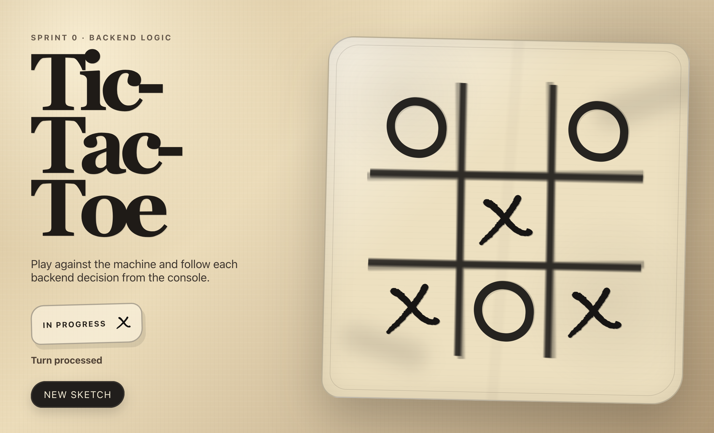
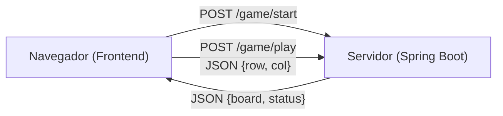

# Repte Java · Tic-Tac-Toe Backend



## Objectiu

Completar la lògica backend d'un joc de **3 en ratlla**.

Rebràs un frontend ja preparat i un backend Java amb Spring Boot. El projecte ja té l'estructura creada i la comunicació entre frontend i backend preparada.

La teva feina serà completar algunes funcionalitats dins del servei del joc.


## Què rebràs?
Descarrega el projecte des d'aquest enllaç: [Tic Tac Toe App](https://github.com/IT-Academy-Back/tic-tac-toe-java)

Al [README del repositori](https://github.com/IT-Academy-Back/tic-tac-toe-java#readme) trobaràs les instruccions per executar el frontend i el backend, així com les indicacions sobre què has de completar.

- Un `frontend` fet amb React.
- Un projecte de `backend` amb Spring Boot i codi Java ja preparat.

---

## Arquitectura del sistema

El sistema segueix l'arquitectura client-servidor: el frontend (navegador) es comunica amb el backend (servidor Spring Boot) mitjançant una API REST que intercanvia dades en format JSON.




## Fitxer que has de modificar

Només has de modificar aquest fitxer:

```text
backend/src/main/java/cat/itacademy/tictactoe/service/GameService.java
```

No cal modificar:

- el frontend,
- el controller,
- els models,
- les classes de request i response,
- els endpoints,
- la configuració del projecte.

---

## Què fa el joc?

El jugador selecciona una casella del tauler. Si la partida no ha acabat, la màquina fa una jugada aleatòria en una casella lliure.

La jugada aleatòria de la màquina ja estarà programada al projecte base. No caldrà implementar aquesta part.

El backend manté l'estat de la partida mentre l'aplicació està en execució. No cal guardar dades en cap base de dades.

L'estructura del tauler ja estarà creada al projecte base. No cal crear l'array des de zero.

El tauler és un array bidimensional de 3x3 (`int[3][3]`). Això vol dir que el podem imaginar com una graella amb **files** i **columnes**.

En Java, per accedir a una casella fem servir aquesta estructura:

```java
board[fila][columna]
```

Les files i les columnes van de `0` a `2`. Per tant, les caselles del tauler es poden localitzar així:

|        | Columna 0 | Columna 1 | Columna 2 |
| ------ | --------- | --------- | --------- |
| Fila 0 | `(0,0)` | `(0,1)` | `(0,2)` |
| Fila 1 | `(1,0)` | `(1,1)` | `(1,2)` |
| Fila 2 | `(2,0)` | `(2,1)` | `(2,2)` |

Per exemple:

- `board[0][0]` és la casella de dalt a l'esquerra.
- `board[1][1]` és la casella del centre.
- `board[2][2]` és la casella de baix a la dreta.

Un tauler buit es pot representar així:

|        | Columna 0 | Columna 1 | Columna 2 |
| ------ | --------- | --------- | --------- |
| Fila 0 | `0` | `0` | `0` |
| Fila 1 | `0` | `0` | `0` |
| Fila 2 | `0` | `0` | `0` |

I un tauler amb una jugada del jugador i una jugada de la màquina es pot veure així:

|        | Columna 0 | Columna 1 | Columna 2 |
| ------ | --------- | --------- | --------- |
| Fila 0 | `0` | `0` | `0` |
| Fila 1 | `0` | `1` | `0` |
| Fila 2 | `0` | `2` | `0` |

Aquest mateix tauler, quan viatja com a resposta JSON, es veu així:

```text
[
  [0, 0, 0],
  [0, 1, 0],
  [0, 2, 0]
]
```

En aquest exemple:

- `board[1][1]` val `1`, per tant hi ha una fitxa del jugador al centre.
- `board[2][1]` val `2`, per tant hi ha una fitxa de la màquina a la fila inferior, columna central.
- Les caselles amb `0` estan buides.

El tauler utilitza aquests valors:

| Valor | Significat |
| ----- | ---------- |
| `0` | Casella buida |
| `1` | Jugador |
| `2` | Màquina |

---

## Endpoints

El projecte base ja defineix aquests endpoints.

### Iniciar partida

```http
POST /game/start
```

Inicia o reinicia la partida i retorna un tauler buit. Aquesta part ja estarà implementada al projecte base.

### Fer una jugada

```http
POST /game/play
```

Rep la jugada del jugador.

Exemple de request:

```json
{
  "row": 1,
  "col": 1
}
```

Exemple de response:

```json
{
  "board": [
    [0, 0, 0],
    [0, 1, 0],
    [0, 2, 0]
  ],
  "status": "IN_PROGRESS",
  "message": "Turn processed"
}
```

---

## Status possibles

| Status | Significat |
| ------ | ---------- |
| `IN_PROGRESS` | La partida continua |
| `PLAYER_WON` | El jugador ha guanyat |
| `MACHINE_WON` | La màquina ha guanyat |
| `DRAW` | La partida ha acabat en empat |
| `INVALID_MOVE` | La jugada no és vàlida |

---

## Què has de completar?

Dins de `GameService.java` trobaràs comentaris que indiquen què falta implementar.

No hauràs de crear l'inici del joc, el tauler, la request ni la response. Aquestes parts ja venen preparades.

Hauràs de completar la lògica per:

- validar si una jugada és correcta,
- comprovar que la casella està dins del tauler,
- comprovar que la casella està buida,
- marcar la jugada del jugador,
- detectar si guanya el jugador,
- detectar si guanya la màquina,
- detectar si hi ha empat,
- retornar l'estat correcte de la partida.

---

## Com provar-ho

1. Arrenca el backend amb IntelliJ.
2. Obre el frontend amb Live Server.
3. Inicia una partida.
4. Fes jugades al tauler.
5. Observa si el joc respon correctament.
6. Si alguna cosa no funciona, revisa `GameService.java`.

També pots obrir DevTools i mirar la pestanya **Network** per veure les peticions a:

- `/game/start`
- `/game/play`

---

## Quan està acabat?

L'exercici està acabat quan:

- pots iniciar una partida,
- pots fer jugades,
- la màquina respon,
- no es poden jugar caselles ocupades,
- no es poden jugar caselles fora del tauler,
- es detecta quan guanya el jugador,
- es detecta quan guanya la màquina,
- es detecta l'empat,
- el frontend mostra l'estat correcte de la partida.

---

## Pistes

Abans de modificar codi, localitza aquests mètodes dins de `GameService.java`:

- `playMove(...)`
- `isValidMove(...)`
- `isInsideBoard(...)`
- `hasWinner(...)`
- `isDraw()`

Recorda conceptes treballats a la introducció de Java:

- arrays,
- condicionals,
- bucles,
- mètodes,
- retorns `boolean`.

---

## Regla important

No intentis canviar tot el projecte. L'objectiu és completar la lògica del joc dins del servei.
